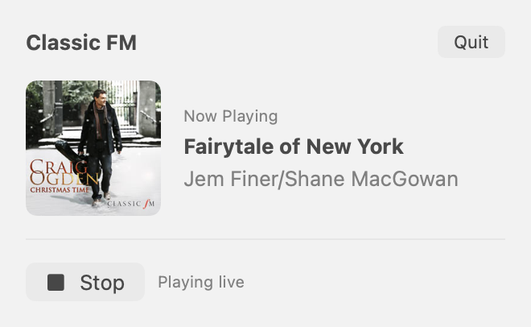

# Classic FM for the Mac menu bar

An unofficial macOS menu bar app for streaming Classic FM live, with now-playing details and one-button playback via Stream Deck.


Click **▶** in the menu bar to play. Click **■** to stop. Each new session starts at the live broadcast. Click **FM ▾** for the piece, composer, cover artwork and playback status. The popover also has a Quit button.

Once you start Classic FM, the Mac keyboard’s **Play/Pause** media key stops and restarts the live stream while Classic FM is the current Now Playing app. If you switch to Music, the key follows macOS’s active player.



## Build and run

Requires macOS 13 or later and Apple’s Command Line Tools or Xcode. The script builds for the architecture of the Mac running it.

```sh
./scripts/build.sh
open "build/Classic FM.app"
```

For a permanent installation, copy **Classic FM.app** and **Toggle Classic FM.app** from `build/` into Applications and open Classic FM once to register its shortcut. A normal launch starts with playback stopped.

## Stream Deck

Add a **System → Open** action to a key. Choose **Toggle Classic FM.app** as the application. Press once to launch and play, again to stop. You can also trigger the same action from Shortcuts or Terminal with this shell command:

```sh
open -g -b com.robmarkcole.classic-fm-menubar classicfmradio://toggle
```

## Switching between Music and Classic FM

Start playback in the Mac’s Music app and Classic FM stops, even while the radio is buffering. Pausing or quitting Music leaves the radio stopped until you press Play again.

Starting Classic FM from the menu bar, popover or Stream Deck asks Music to pause if it is running. **Pause Music when starting Classic FM** is on by default. Uncheck it in the **FM ▾** popover to leave Music alone when starting the radio. Your choice is saved across launches.

macOS may ask for Automation access the first time Classic FM tries to pause Music. If you decline, the radio still plays and you can pause Music yourself. You can change access later in **System Settings → Privacy & Security → Automation**.

## Audio and track information

AVPlayer plays the regular [Classic FM MP3 feed](https://media-ssl.musicradio.com/ClassicFMMP3), including adverts. The station reports 128 kbps stereo. While the popover is open, it checks the [station’s Now Playing card](https://www.classicfm.com/dynamic/now-playing-card/) about every five seconds. It uses the top card’s own heading, including “Recently Played” between pieces. Missing artwork gets a placeholder. A failed card request leaves playback running.

In a live check on 25 November 2026, the first poll showing Shostakovich’s *Jazz Suite No. 2 (6)* was at 17:03:16 GMT. A muted AVPlayer playing the same feed delivered the matching timed stream title at 17:03:35. The observed display lead was 19 seconds, with about five seconds of polling granularity. This measures the title marker carried with buffered audio. The first audible note can fall elsewhere. The app applies no fixed timing correction.
